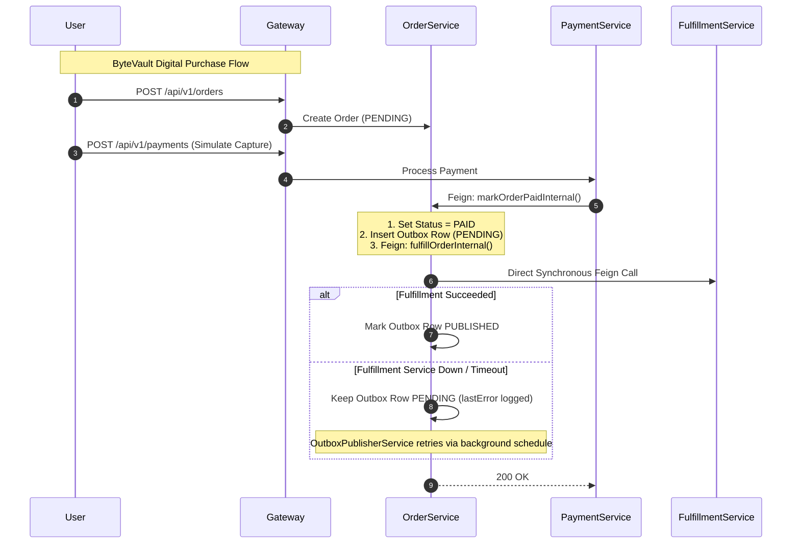

# ByteVault Media — Architectural Analysis & Syllabus Verification (CO-1)
## SOA, SOAP vs. REST, Communication Patterns & Load Balancing in Modern Microservices

---

### Executive Summary

ByteVault Media is an enterprise digital media marketplace engineered strictly against Course Outcomes **CO-1 through CO-4**. This technical treatise addresses the theoretical and empirical foundations required under **CO-1 (Service-Oriented Architecture, Web Services, Inter-Service Communication, and Load Balancing)**.

The system is decomposed into 7 core autonomous microservices:
1. **Identity Service** (Merged Authentication, RBAC, User Profiles, and Vendor Lifecycle)
2. **Product Catalog Service** (Digital Asset Governance, Categories, and Vendor Read/Write Gates)
3. **Cart Service** (High-Performance Shopping Cart with In-Database User Isolation)
4. **Order Service** (Order State Machine and Transactional Outbox Pattern)
5. **Payment Service** (Payment Verification and Financial Ledger)
6. **Fulfillment Service** (Cryptographic License Keys and Ephemeral Presigned URLs)
7. **Notification Service** (Transactional Confirmation Dispatching)

These services are coordinated via **Netflix Eureka Service Discovery**, governed by a reactive **Spring Cloud Gateway**, and connected via declarative **OpenFeign** clients with client-side load balancing.

---

## 1. Architectural Foundations: SOA vs. Microservices Architecture

| Architectural Dimension | Classical Service-Oriented Architecture (SOA) | Modern ByteVault Microservices Architecture |
| :--- | :--- | :--- |
| **Component Boundary** | Coarse-grained enterprise services sharing legacy integrations. | Fine-grained single-responsibility bounded contexts (DDD). |
| **Integration Backbone** | Heavyweight **Enterprise Service Bus (ESB)** with transformation logic and orchestration. | **Smart endpoints and dumb pipes** (Lightweight HTTP/REST via Spring Cloud Gateway). |
| **Data Governance** | Shared enterprise database schemas across multiple services. | **Database-per-Service pattern** (PostgreSQL databases isolated per bounded context). |
| **Communication Protocols**| Predominantly XML-over-SOAP, WSDL, WS-*, JMS, and CORBA. | Stateless JSON-over-REST, OpenFeign, and HTTP/2. |
| **Deployment Independence** | Monolithic releases; services frequently share runtime application servers. | Indepedently buildable, deployable, and scalable JAR artifacts. |
| **Failure Blast Radius** | High; single ESB or database failure degrades entire enterprise. | Isolated; failures are quarantined via circuit breakers, timeouts, and outbox retries. |

---

## 2. In-Depth Comparison: SOAP vs. REST Web Services

Course Outcome 1 requires an exhaustive academic comparison between SOAP (Simple Object Access Protocol) and REST (Representational State Transfer).

### 2.1 Comparative Analysis Matrix

| Criterion | SOAP (Simple Object Access Protocol) | REST (Representational State Transfer) | ByteVault Architectural Justification |
| :--- | :--- | :--- | :--- |
| **Fundamental Nature** | Formal strict **Protocol** governed by W3C specifications. | **Architectural Style** leveraging standard web protocols. | ByteVault adopts REST to eliminate XML parsing overhead and support modern frontend clients. |
| **Message Format** | Strictly **XML** wrapped in SOAP Envelopes (Header, Body, Fault). | Polyglot (JSON, Protocol Buffers, YAML, XML); ByteVault standardizes on **JSON**. | JSON reduces wire payload by ~60% compared to XML envelope verbosity. |
| **Contract Definition** | Rigid **WSDL** (Web Services Description Language) file. | **OpenAPI 3.0 / Swagger** and JSON Schema contracts. | OpenAPI provides interactive Swagger UI testing and dynamic client generation. |
| **Transport Protocol** | Transport-agnostic (HTTP, SMTP, JMS, TCP, MQ). | Tightly coupled to **HTTP/HTTPS** methods (GET, POST, PUT, DELETE, PATCH). | Leverages native HTTP semantics, response codes (200, 201, 400, 401, 403, 404, 500). |
| **Security Standards** | **WS-Security** (XML digital signatures, XML encryption at message level). | **Transport Layer Security (TLS/HTTPS)**, OAuth2, JWT Bearer tokens, and perimeter headers. | Stateless JWT + `X-Gateway-Secret` eliminates message-level encryption CPU bottlenecks. |
| **State & Caching** | Typically stateful or operation-centric; poor HTTP caching support (POST only). | **Stateless by definition**; idempotent methods (GET, PUT, DELETE) are naturally cacheable. | Read queries are cacheable; Gateway easily applies rate-limiting and reverse-proxy caching. |
| **Performance & Bandwidth**| High overhead due to heavy XML envelopes and parsing costs. | Lightweight, low latency, fast deserialization via Jackson. | Sub-millisecond JSON serialization optimizes inter-service Feign throughput. |

---

## 3. Inter-Service Communication: Orchestration, Choreography & Event Patterns

Microservices interact using three primary structural patterns:

```
[Inter-Service Interaction Patterns]
├── 1. Orchestration (Centralized Workflow Coordinator)
│   └── Controller / Coordinator drives explicit synchronous steps across services
├── 2. Choreography (Decentralized Pub/Sub Event Diffusion)
│   └── Services emit events to a message broker; downstream consumers react autonomously
└── 3. ByteVault Hybrid Architecture: Synchronous REST + Transactional Outbox
    └── Direct Feign calls for low-latency critical path; local outbox table guarantees delivery
```

### 3.1 Orchestration vs. Choreography Comparison



### 3.2 Kafka Evaluation and Architectural Trade-Off Analysis

Under CO-1, messaging backbones such as **Apache Kafka** are evaluated:

1. **Kafka Strengths**:
   - High-throughput append-only distributed commit log.
   - Partitioning model enables horizontal consumer scaling and strict partition ordering.
   - Long-term event replayability and event sourcing support.

2. **Why Kafka was Not Selected for ByteVault's Current Operational Runtime**:
   - **Infrastructure Footprint**: Running a multi-broker Kafka cluster with ZooKeeper or KRaft metadata quorum requires substantial compute, disk, and RAM allocations (often >2GB RAM solely for brokers).
   - **Operational Fragility**: In local development and resource-constrained environments, brokers can silently stall or drop socket connections, causing silent queue blocking.
   - **The Transactional Outbox Solution**: ByteVault achieves identical **at-least-once delivery guarantees** and **zero data-loss resilience** using a native PostgreSQL Transactional Outbox table (`outbox_events`). When the downstream `fulfillment-service` or `notification-service` is temporarily unreachable, the transaction is saved locally and safely retried by `OutboxPublisherService` every 2,000 ms.

---

## 4. Load Balancing & Service Discovery: Client-Side vs. Server-Side

Course Outcome 1 mandates practical demonstration of service discovery and load balancing.

### 4.1 Server-Side vs. Client-Side Load Balancing

```
A. Server-Side Load Balancing (Traditional NGINX / F5 / AWS ALB)
Client ─────────► [ Load Balancer Appliance ] ─────────► Instance 1
                                               ─────────► Instance 2
(Single point of failure, extra network hop, centralized configuration bottleneck)

B. Client-Side Load Balancing (ByteVault Media: Spring Cloud LoadBalancer + Eureka)
[ Client / Feign ] ──(1. Query registry)──► [ Eureka Discovery Server ]
       │            ◄──(2. Cached instances)──
       │
       └──(3. Direct connection to selected instance via Round-Robin)──► Instance 1 / Instance 2
```

### 4.2 Spring Cloud LoadBalancer Implementation

ByteVault Media utilizes **Spring Cloud LoadBalancer** integrated transparently with **Spring Cloud OpenFeign** and **Spring Cloud Gateway**:
- **Discovery**: When `order-service` calls `product-service` via `@FeignClient(name = "product-service")`, Feign queries the local Eureka cache.
- **Algorithm**: The default algorithm is **Round-Robin** across all healthy registered service instances.
- **Fault Tolerance**: If an instance fails heartbeat health checks, Eureka de-registers it during lease expiration, preventing traffic routing to degraded nodes.
