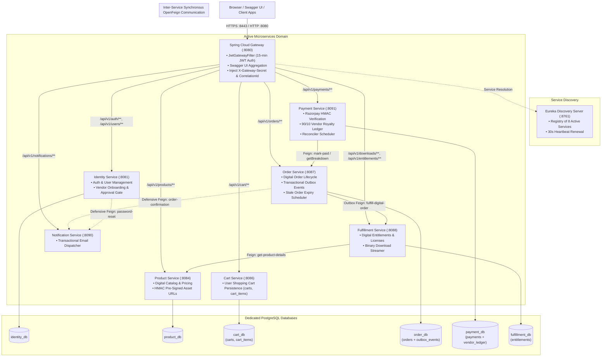
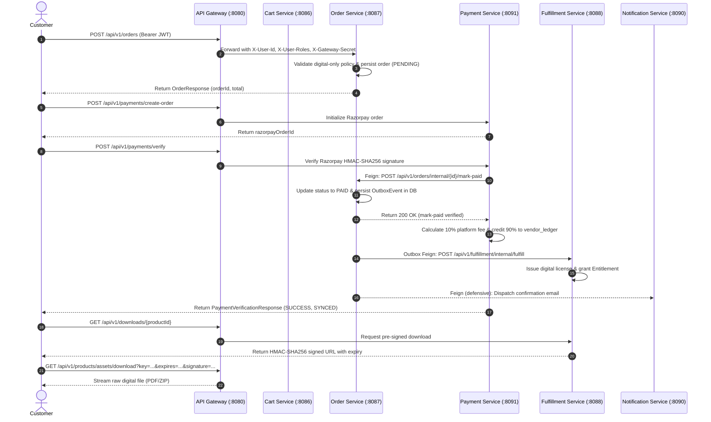

# ByteVault Media — Microservices Architecture Specification (Review 2)

**System:** ByteVault Media — Cloud-Native Digital Asset & Engineering Platform  
**Target Architecture:** Simplified, Highly-Reliable Synchronous Microservices Architecture  
**Runtime:** 8 Active Services + 1 Eureka Discovery Server + 6 PostgreSQL Databases  

---

## 1. Architectural Philosophy & Decisions

Prior iterations of this project included dormant modules, RabbitMQ event brokering, and standalone Spring Cloud Config Server. Through empirical refinement for Review 2:
1. **Zero Message Brokers on Digital Path:** RabbitMQ was replaced with synchronous OpenFeign inter-service communication coupled with the **Transactional Outbox Pattern** in PostgreSQL (`order_db.outbox_events`). This eliminated broker connection overhead and operational complexity, providing at-least-once delivery within the retry window (20 attempts with exponential backoff up to 30s cap = ~8.5 minutes); after that, the event is marked `FAILED` and flagged for manual handling / administrative reconciliation.
2. **Zero Cache Servers:** Redis was eliminated. Cart persistence was consolidated into PostgreSQL `cart_db` using normalized relational tables (`carts` and `cart_items`).
3. **Database-per-Service Isolation:** 6 independent PostgreSQL databases (`identity_db`, `product_db`, `cart_db`, `order_db`, `payment_db`, `fulfillment_db`). No cross-database joins or queries are permitted. All cross-boundary data is obtained via declarative OpenFeign REST clients (`CommonFeignConfig`).
4. **Digital-Only Enforcement:** Physical inventory, shipping, and warehouse microservices are kept dormant (`app.physical-products.enabled=false`) to ensure 100% stable, demonstrable digital flows for Review 2.
5. **Zero-Trust Downstream Perimeter:** Downstream services reject any request lacking the shared `X-Gateway-Secret` header injected by Spring Cloud Gateway (`DownstreamSecurityFilter`).
6. **Email Notification Dispatch:** Explicit separation of responsibilities:
   - `IdentityService`: Dispatches password reset emails (`/api/v1/auth/forgot-password`).
   - `OrderService`: Dispatches order confirmation emails via its transactional `OutboxPublisherService` calling `NotificationService`.
   - `PaymentService`: Does NOT call `NotificationService`.

---

## 2. System Architecture Diagram

---

## 3. Distributed Request Flow (Digital Purchase & Royalty Lifecycle)

> **Exported Static Diagram Assets:**
> - System Architecture: [SVG](file:///d:/ProductManagementSystem/docs/diagrams/system-architecture.svg) | [PNG](file:///d:/ProductManagementSystem/docs/diagrams/system-architecture.png)
> - Digital Purchase Sequence: [SVG](file:///d:/ProductManagementSystem/docs/diagrams/digital-purchase-flow.svg) | [PNG](file:///d:/ProductManagementSystem/docs/diagrams/digital-purchase-flow.png)

---

## 4. Resilience & Fault Tolerance Patterns

1. **Transactional Outbox Pattern (Order -> Fulfillment):**
   - When an order transitions to `PAID`, an outbox record is persisted in `order_db.outbox_events` in the same local database transaction.
   - If `Fulfillment Service` is down or unreachable, the synchronous call fails gracefully without rolling back payment.
   - `OutboxPublisherService` runs every 2 seconds on a background thread, retrying pending events with capped exponential backoff up to 20 attempts.
2. **Scheduled Reconciliation Backfill (Payment -> Ledger):**
   - `PaymentOrderSyncService.reconcileLedgerEntries()` runs every 60 seconds.
   - Identifies any paid transaction missing a corresponding entry in `vendor_ledger` and automatically backfills the 90/10 royalty credit.
3. **Stale Order Expiry Scheduler:**
   - `OrderExpiryService` runs every 60 seconds.
   - Finds orders remaining in `PENDING` status for greater than 30 minutes and transitions them to `CANCELLED`.
4. **Defensive Notification Isolation:**
   - Feign client calls to `notification-service` use strict 3-second connect and read timeouts.
   - Failures (e.g., SMTP unreachable) are caught and logged as warnings; they never abort the parent transaction.

---

## 5. Course Outcome 1 (CO-1): SOAP vs. REST Architectural Comparison

As required by Course Outcome 1, ByteVault Media maintains an extensive architectural treatise comparing Service-Oriented Architecture (SOAP) and RESTful Microservices:
- Document: [BYTEVAULT_SOAP_VS_REST_ARCHITECTURE.md](file:///d:/ProductManagementSystem/BYTEVAULT_SOAP_VS_REST_ARCHITECTURE.md)
- **Key Dimensions Evaluated:**
  - **Protocol & Serialization:** WSDL/XML/SOAP Envelope vs. OpenAPI/JSON/HTTP Verbs.
  - **Transport & Tight Coupling:** Rigid RPC contract coupling vs. resource-oriented URI decoupling.
  - **Performance & Latency:** XML serialization overhead vs. lightweight Netty non-blocking JSON streaming.
  - **Distributed Security:** WS-Security (XML-DSig, XML-Enc) vs. stateless JWT (RFC 7519) and gateway secret propagation.
